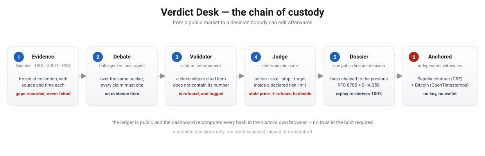

# Verdict Desk

**An autonomous agent makes a market decision. Verdict Desk turns it into evidence a lawyer can file.**

Audit-grade, replayable decisions for AI market agents. Simulated only: no order is ever placed.

**Why it exists.** When an autonomous agent acts, the people who answer for it afterwards (an auditor, a compliance officer, a lawyer) need two things: exactly what the agent saw and decided at that moment, and a way to check that record without taking the operator's word for it. Verdict Desk produces that trail. Each decision is frozen as a **dossier**: the evidence the agent saw, with its sources and times, the arguments for and against, and the verdict. Dossiers are hash-chained, so editing a record leaves a mark that anyone can find by recomputing the hashes in their own browser, with no account and no server in the loop. Rewriting every later hash would hide an edit inside the chain but changes its head, so the head is published where the operator cannot quietly rewrite it: in git history today, and in an on-chain anchor on Sepolia that the CRE workflow wrote on 2026-10-21 (the evidence is below). The reasoning can be re-run from the frozen evidence and either gives the same verdict or shows exactly where it differs. The trail shows what was decided and why; it does not show that a decision was right, and this repository makes no claim about customers or deployments. The agent here trades on paper only, so the mechanism can be tested in public.

How it works in one paragraph: Verdict Desk reads public market evidence, freezes it, lets a bull agent and a bear agent argue over the same facts, and lets a deterministic judge size a *simulated* position inside declared risk limits. Every decision becomes a dossier that is hash-chained to the one before it. Open the dashboard, press **Test the chain**, and break the chain yourself in 30 seconds.

Built for the BLI Legal Tech Hackathon 2 (bounty "Autonomous Agents", with a Chainlink CRE workflow for the second bounty).

**Market voices (the multi-KOL spotlight):** [`web/narrative.html`](web/narrative.html) — the featured direction: who converged, on what, and every token that never did, with the reason. Published at `https://andriyamaro.github.io/verdict-desk/narrative.html`.

**Judge path (start here):** [`web/judge.html`](web/judge.html) — every requirement of both bounties, each one mapped to the file, command or transaction that proves it, with the live numbers recomputed from the ledger in the visitor's browser. Published at `https://andriyamaro.github.io/verdict-desk/judge.html`.

**Watch it first (narrated, 77 s):** [`web/demo/verdict-desk-demo-v4.mp4`](web/demo/verdict-desk-demo-v4.mp4) — eight scenes, every frame a real rendered page driven by Playwright: the live hero, the one-click tamper demo turning the banner red, the cause-and-effect lab with its deciding argument, the anchored exhibit, the verify page, and the scorecard with its losing rows. Published at `https://andriyamaro.github.io/verdict-desk/demo/verdict-desk-demo-v4.mp4`.

Also available: the earlier [2-minute silent recording](web/demo/verdict-desk-demo.mp4) of raw terminal output. Recorded on 2026-10-20 against commit `ff8519a`; the on-screen numbers in that older file (46 dossiers) are from that day and are kept as history.

## What the bounty asks, and where to look

| The bounty asks for | Verdict Desk | Look here |
|---|---|---|
| Interpret market evidence | One frozen evidence packet per decision: candles, funding, news, and the narrative of public voices, each with source and time | `verdict_desk/evidence.py`, `narrative.py` |
| Record the simulated operation | Entry, size, stop, target and the portfolio marked against later candles | `verdict_desk/agents.py`, `portfolio.py` |
| Cause and effect | Every argument names the evidence item it rests on; LLM claims must cite item ids and numbers that really appear there | `verdict_desk/citations.py`, dashboard row details |
| A repeatable reasoning trail | `replay` re-derives the verdict from the frozen packet; `verify` checks the hash chain | `verdict_desk/dossier.py` |
| Chainlink CRE (second bounty) | A CRE workflow plus a receiver contract that anchor the ledger head and a Data Feed price on Sepolia, with the contract **source-verified (exact match)** | `cre/` (status table inside); evidence file `cre/SIMULATION-OUTPUT.md` (complete: simulation, Sepolia deployment and the anchored head of dossier 80); `cre/VERIFICATION.md` (source verification record and how to reproduce it) |

### Special Project Spotlight: the narrative agent this build already runs

The bounty's spotlight describes an agent that monitors user-selected crypto voices, extracts the token, sentiment, conviction and urgency from what they say, detects when independent voices converge on the same narrative, and turns that into a practice position under transparent rules and risk limits. That agent exists here and runs on every hourly decision:

| Spotlight requirement | What runs today | Measured evidence |
|---|---|---|
| Up to 20 user-selected voices | 5 default crypto newsroom and creator feeds, extensible to 20 via `--feed NAME=URL` (RSS/Atom) | 40 headlines per run; 90 of 98 dossiers carry a narrative layer |
| Tokens, sentiment, conviction, urgency | LLM extraction per headline into a closed vocabulary, each with a literal quote from the headline | 14 extractions accepted and 13 rejected by the grounding gate in the latest dossier |
| Convergence across distinct voices | A narrative needs at least two different voices on the same token **and** the same stance | **101 convergences** recorded across the live ledger |
| Explain the candidates it rejected | Every mentioned token that did not become a narrative is kept with its reason: only one voice, voices disagreeing, or neutral mentions only | `narrative.rejected_candidates`, frozen in the dossier |
| Practice position under transparent rules and risk limits | The convergence becomes a citable evidence item; the deterministic judge sizes a simulated position at 1% risk with an ATR stop and target | `verdict_desk/agents_v2.py`, `portfolio.py` |

Example from the live ledger: BTC bullish, converging across **CoinDesk, Cointelegraph, Decrypt and The Block**, top conviction *high*, top urgency *medium* — and that convergence is one of the items the judge is allowed to cite when it rules.

**One honest gap:** the spotlight names X as the KOL source. This build reads public RSS/Atom feeds, because the X API is paid and the project runs at zero budget. The voice adapter accepts **any** feed URL, so an X or Telegram source works through a public RSS bridge without touching the extraction, convergence or grounding logic — which is covered by a test that parses an X-shaped feed:

```bash
python3 -m verdict_desk decide-v3 BTCUSDT --feed "kol=https://<your-rss-bridge>/<handle>/rss" --feed "chan=https://<your-rss-bridge>/telegram/<channel>"
```

What this repository does not claim is a native X API integration that does not exist.

## Verifying a record someone hands you

A dossier that arrives as a file — forwarded, copied out of an email, transcribed — should not
require trusting the sender or this site. [`web/verify.html`](https://andriyamaro.github.io/verdict-desk/verify.html)
takes a pasted record and runs three checks in the reader's own browser:

| Check | What it catches |
|---|---|
| **Integrity** | the SHA-256 over the record's canonical JSON is recomputed; a single edited character fails it |
| **Linkage** | the record's `prev_hash` is matched against the previous record in the published ledger, so the file is part of a chain rather than a standalone claim |
| **Re-derivation** | the stored arguments are pushed back through `web/policy.js`; if today's rules produce a different action, the record no longer explains itself and the page says so |

The re-derivation uses the freshness window that record was made under, not today's, because an old
record should not fail for a rule that changed after it was written.

`bash scripts/check_pages.sh` renders every page in headless Chromium and asserts on the DOM, since
a page that renders nothing still returns HTTP 200.

## A third-party clock that needs no wallet

An on-chain anchor requires a funded key, so the hourly cadence pauses whenever the CI secrets are
absent. This does not: every run stamps the published head with **OpenTimestamps**, submitting the
digest to independent public calendars that commit it into a Bitcoin block. No key, no funds, no
account.

```bash
python3 -c "import json;print(json.load(open('ledger/head.json'))['seq'])"   # e.g. 116
ots verify ledger/timestamps/116.json.ots      # any machine, no trust in us required
```

Two details that decide whether this is evidence or decoration:

- **Proofs are archived per record.** A `.ots` proves the exact bytes that were stamped, so
  overwriting one file each hour would silently invalidate every earlier proof. Each record keeps
  its own snapshot and proof, and a test checks that every snapshot equals the published hash of
  that record.
- **Pending is a state, not a failure.** A fresh proof reads *pending confirmation in Bitcoin
  blockchain* until a block confirms it; later runs upgrade the earlier proofs.

## Decision exhibits: the record as a document, not a log line

`python -m verdict_desk exhibit <seq>` renders one dossier as a self-contained, printable document. It exists because a legal reviewer asks a different question than an engineer: *can I rely on this in a dispute?* Each exhibit answers it in seven sections:

| Section | What it establishes |
|---|---|
| 1. What the agent saw, and when | Custody: every source, item count and age, with freshness judged per source class |
| 2. Who argued what | Each claim next to the **evidence text it cites**, and each claim refused with the exact reason (`number not in cited evidence: 1.6`) |
| 3. Which argument decided it | The record's own sensitivity block: the edge and action that would remain without each argument, with the deciding ones marked |
| 4. The decision | Action, edge, entry, stop, target, size, declared risk and the system cap |
| 5. Market voices | Converging narratives and the tokens that never converged, with reasons |
| 6. Integrity | The hash **recomputed when the exhibit was rendered** against the recorded one, the previous link, the chain position, and the on-chain anchor status |
| 7. What this exhibit does not prove | Simulated only, no orders, fees excluded, LLM opinions validated for citation and not for merit, secondary sources inherit their errors |

The live site publishes the last five exhibits plus the anchored record, regenerated on every hourly run: [`web/exhibit/`](https://andriyamaro.github.io/verdict-desk/exhibit/index.html).

## The chain of custody in one image



Six stages, none of which can be skipped: evidence is frozen, debated with citations, validated,
ruled on deterministically, hash-chained into a dossier, and independently anchored — on Sepolia
through the CRE workflow and in Bitcoin through OpenTimestamps. The last row of each box states
what fails closed.

## Try the cause-and-effect lab

`web/lab.html` answers, in the browser, the two questions a reviewer actually asks:

1. **Which single argument decided this verdict?** Pick any dossier from the published ledger and the page shows, per argument, the edge and the action that would remain if that argument were removed — with the verdict-deciding ones highlighted. This is the dossier's own recorded `sensitivity` block, not a re-run.
2. **What rule would fire for inputs I choose?** Move the sliders and the state is named with the exact rule that produced it: entry band, high-volatility rule, the freshness gate, and fail-closed behaviour on stale price.

The playground is a mirror of the judge in `web/policy.js`. A mirror that is never compared is a second implementation waiting to lie, so `tests/test_policy_parity.py` runs it over 486 input combinations and fails when any state differs from what `verdict_desk/agents_v2.py` returns for the same numbers.

## Risk limits are the user's, inside a ceiling the system owns

`--risk-pct` sets the risk per practice position (default 1%). The system refuses anything above **25%** instead of silently clamping it, and every dossier freezes both numbers — so an auditor sees the limit that was declared next to the cap that governed it, and a replay reapplies the same limit rather than the default.

```bash
python3 -m verdict_desk decide-v3 BTCUSDT --risk-pct 2
python3 -m verdict_desk decide-v3 BTCUSDT --risk-pct 30   # refused: exceeds the system cap of 25%
```

## Freshness is judged per source class, not as one number

A single window is wrong in both directions: it either accepts a stale price (dangerous) or discards a good headline (silly). Price is checked against a **75-minute** window and **blocks** the decision; news and market voices are checked against a **26-hour** window and only **warn**, because yesterday's headline is still auditable while yesterday's price is not. The result is frozen into every dossier under `evidence.freshness.classes`.

## Five-minute judge path

1. Open the dashboard (the GitHub Pages site of this repository). It loads `ledger/ledger.jsonl` and shows the banner "Every hash recomputed in this browser matches". It does not trust the server: the hashing runs locally in `web/canonical.js`.
2. **Test the chain (30 seconds, one click, nothing to download).** Press **Test the chain**. It flips one decision in a copy held in your tab: the row turns red, the banner says the chain no longer verifies and names the dossier, and a three-row table shows the recorded hash next to the one your browser recomputed. "Tamper and re-hash" plays the cleverer attacker: the edited row looks valid again, but the next row no longer links to it (`chain broken`). "Rewrite the whole chain" shows the limit: everything verifies again, but the head hash is different, which is why the head is published outside the operator's reach (git history, other clones, and the on-chain anchor on Sepolia). You can also edit a decision by hand, or download the tampered copy and run `python3 -m verdict_desk --ledger ledger-tampered.jsonl verify`: the Python verifier reports the same dossier. Nothing is sent anywhere and the server's file is never touched.
3. Read the three panels above the table: the **cadence** of the live history (every gap between runs, nothing filled in), the **LLM debate** counts (claims the citation validator accepted and rejected) and the **simulated portfolio** (recomputed in your browser with the same rule as `portfolio.py`). Then click a row. You see the deterministic bull and bear arguments with the exact indicator behind each one, then the LLM analysts' claims with the evidence id each one cites, and the claims the validator **rejected**, with the reason. The LLM debate works from dossier **46** on; the section "Live operation" below says what the earlier dossiers show.
4. Run it yourself:

```bash
python3 -m unittest discover -s tests          # standard library only (283 tests)
python3 -m verdict_desk verify                 # hash chain of ledger/ledger.jsonl
python3 -m verdict_desk replay                 # re-derive every verdict from its frozen evidence
python3 -m verdict_desk portfolio              # simulated positions marked against later candles
python3 -m verdict_desk stats --git            # the live-operation numbers below, counted from the ledger
python3 -m verdict_desk export --seq 95 --out pack.json   # self-verifying evidence pack for one dossier
python3 -m verdict_desk monitor                # compare the ledger with the head anchored on Sepolia
```

## How it works

```
public data ──> frozen evidence packet ──> bull agent ┐
(candles, funding,   (source + time on     bear agent ├─> deterministic judge ──> dossier (hash-chained)
 news, RSS voices)    every item)          narrative  ┘     size, stop, target        │
                                                                                      └─> ledger/ledger.jsonl ──> dashboard, replay, CRE anchor
```

- **Evidence.** Binance public spot mirror (candles), OKX public funding, GDELT news, and public RSS or Atom feeds. No API key is needed for any of them. A source that fails reduces the evidence and is recorded as a gap; it never fakes a decision.
- **Fail-closed on stale evidence.** Market evidence carries a freshness window (2 hours). The age of the newest candle is computed when the packet is frozen and stored inside it, so the check itself is replayable and never reads the clock later. If the evidence is older than the window the judge returns **`BLOCKED_STALE`** and sizes no position: it refuses to decide on a stale price instead of quietly extrapolating one. The refusal is written into the dossier, so a blocked decision is as auditable as a taken one, and the portfolio only ever opens LONG or SHORT. Dossiers recorded before this gate existed have no freshness key and keep replaying unchanged.
- **Evidence pack.** `python3 -m verdict_desk export --seq N --out pack.json` writes one dossier as a self-contained file for a third party: the recomputed hash next to the recorded one, the replay result, the neighbouring hashes that pin it in the chain, the plain-language steps to check it without trusting the exporter, and a `pack_digest` over the whole thing. Anything edited anywhere in the pack changes that digest.
- **Agents.** The bull and bear analysts are LLM agents (Mistral API, free tier) that must cite evidence ids. A validator discards any claim with no citation, an unknown id, or a number that is not in the cited items. The judge that decides action, size, stop and target is deterministic code, so the same frozen packet always yields the same verdict.
- **Named states (rules v3).** When the evidence does not justify an entry, the verdict says why instead of returning a flat `FLAT`. `WATCH_REVERSAL` means one single argument is worth enough that losing it would flip the decision, and the rationale names that argument. `REDUCE_EXPOSURE` means both sides are strong while volatility is high, so nothing new opens and existing exposure should shrink. The thresholds, the sizing and the entry decisions are identical to v2: only the label of a decision that was not taken changed. v2 dossiers keep replaying under v2, which is why the version travels inside each dossier.
- **Cause and effect.** Each dossier also freezes a sensitivity table: how much more net edge would flip the verdict to LONG or SHORT, and, for each argument, what the verdict would be without it (and whether that single argument decides it). It comes from the same arguments and weights the judge used, so it is deterministic and replayed too.
- **Narrative agent.** Reads up to 20 public voices. The LLM extracts token, stance, conviction and urgency per headline. Headlines are untrusted input, so each extraction must carry a quote that is a literal part of the headline, a voice id that exists and values from a closed vocabulary; anything else is dropped and logged in the packet. Convergence needs at least two distinct voices on the same token and stance. If the model is down the packet says `keywords` and uses a plain word-list fallback.
- **Ledger.** JSONL, one dossier per line, each with `prev_hash` and its own `hash` over RFC 8785 canonical JSON. The same canonicalization runs in Python and JavaScript, with shared test vectors, which is what lets the browser recompute the exact hash Python wrote.
- **Anchor monitor.** A CRE workflow anchors the head of the chain on Sepolia. `python3 -m verdict_desk monitor` (read-only, no key) reads the anchored value back from the contract and compares it with the dossier of that same sequence in the published ledger: it prints MATCH, or names the divergence. Rewriting old dossiers breaks this even if every local hash is recomputed, which is the limit the dashboard's "Rewrite the whole chain" button demonstrates. The hourly workflow runs it as a guard: a mismatch fails the run, an unreachable RPC only warns.
- **Frozen LLM output.** The model's words are stored in the dossier and are not regenerated on replay. Replay re-derives everything deterministic and re-checks that each stored citation is still valid against the frozen evidence.

## Live operation, measured from the ledger

<!-- live-numbers: generated from dossier 134 by `python3 scripts/refresh_numbers.py` (counts: `python3 -m verdict_desk stats --git`) -->
Counted over `ledger/ledger.jsonl` on the chain as of **dossier 134** (head `53e590c948014afc`, collected 2026-10-22 23:37 UTC), after `verify` passed. Nothing is estimated: every figure is a count over ledger lines, plus `git blame` of that file for the author rows. The dashboard recomputes the same numbers in your browser from whatever ledger you load, and a test checks that the Python and the JavaScript agree on this ledger. The chain grows with every run, so these figures are a snapshot; the dashboard and the commands below always show the current chain.

| What | Number |
|---|---|
| Dossiers in the verified chain | 134 (BTCUSDT 57, ETHUSDT 51, SOLUSDT 26) |
| Operating window, first to last dossier | 134.2 h, 5.6 days (2026-10-17 09:26 to 2026-10-22 23:37 UTC) |
| Clock hours (UTC) in that window with at least one dossier | 38 of 135 (28.1%) |
| Longest gap between consecutive dossiers of the same symbol | 8 h 34 min (SOLUSDT); 71 gaps over 90 minutes |
| Recorded by the workflow bot (scheduled or manually dispatched runs) | 119 (dossiers 1-53, 69-134) |
| Recorded by other commits | 15 (dossiers 54-68): runs made outside the workflow while the demo tooling and the v2 rules were being built; the ledger is append-only, so they stay |
| LLM era, dossier 46 onward | 89 dossiers, 84 with analyst output (dossiers 54-58 have no LLM layer) |
| Claims **accepted** by the citation validator | 572 (bull 305, bear 267) |
| Claims **rejected** by the citation validator | 71 (bull 30, bear 41); reason: "number not in cited evidence" 71 |
| Share of claims accepted | 89.0% |

The window is not continuous coverage: scheduled GitHub runs are best effort and most hourly slots did not fire, which is why the coverage and gap rows sit next to the window. The dashboard's cadence panel shows the same figures.

Earlier dossiers stay exactly as they were recorded, so the history of how the LLM layer came to work is in the ledger itself:

| Dossiers | What the ledger shows |
|---|---|
| 1 to 4 | No LLM layer: no key was set (the dashboard shows these as "off") |
| 5 to 34 | The first model provider (an NVIDIA-hosted model) answered HTTP 403 on every call: 60 analyst calls failed, each failure recorded in its dossier |
| 35 to 45 | Mistral analysts answered, but 0 of 48 claims passed the validator (44 cited an id that does not exist, 4 used a number that is not in the cited item) |
| 46 onward | Analysts answer and claims pass the validator, as counted above |

Reproduce any row:

```bash
python3 -m verdict_desk stats --git                                  # the table above
python3 -m verdict_desk stats --first-llm-seq 35 --last-llm-seq 45   # an earlier range, e.g. the third row of the history
python3 -m verdict_desk stats --json                                 # every number, machine readable
```

## Auditing someone else's agent

`audit-journal` takes the journal of an autonomous agent (one turn per line, with the evidence it saw) and does two things. First it checks every candle and price the journal recorded against public Binance data, counting only candles that had already closed at the turn time and comparing prices within a small tolerance because the agent reads perpetual futures while the public mirror is spot (volume is not compared). Second it replays each symbol-hour in shadow: the desk builds a packet from candles closed at that moment plus the funding the journal recorded, applies the same rules, and reports what it would have recorded next to what the agent did. The output is labeled as a shadow replay and never as a trade result, and the journal's free-text reasoning is never copied into it.

## Honest results

These numbers are tests on past data, not live trading results, and they are published because the system is a reasoning-trail tool, not a money machine.

| Walk-forward backtest, rules v1, latest 4,000 hourly candles on 2026-10-17, 0.05% fee per side | Net return | Profit factor | Buy and hold |
|---|---|---|---|
| BTCUSDT | -18.66% | 0.85 | -0.1% |
| ETHUSDT | -9.98% | 0.92 | +3.13% |
| SOLUSDT | +1.31% | 1.01 | +17.98% |

Each `backtest` run prints the sha256 of its candle series so the numbers can be reproduced on the same data. The window rolls, so a later run on newer candles will differ.

The offline study in [`research/`](research/README.md) searched a tuned set of v1 parameters (choose on the first 60%, judge on the last 40%, 36 candidate settings). It beat v1 out of sample on 3 of 3 symbols but was net positive on only 1 of 3 and never beat buy and hold, so it was not adopted.

**Which rules record the live dossiers.** The backtest above is for the v1 rules, which recorded dossiers 1 to 53 and a few manual comparison runs. The hourly workflow now records with the v2 rules in `verdict_desk/agents_v2.py`: the v1 arguments plus RSI, MACD and Bollinger arguments, and an entry threshold of 1.5 instead of 2.0. Each dossier says which rules recorded it in `verdict.rules_version`, and `replay` re-derives it with those rules. The v2 rules are not the tuned parameters of the study above, and **they are not covered by the backtest table**: it describes v1 only. How they split between LONG and SHORT, tested against a mirrored market, and what they earned in the same walk-forward protocol, is measured in [`research/V2_DIAGNOSIS.md`](research/V2_DIAGNOSIS.md).

## Live history

The workflow [`.github/workflows/hourly.yml`](.github/workflows/hourly.yml) is scheduled every hour. Each run appends decisions for BTCUSDT, ETHUSDT and SOLUSDT with `decide-v2`, verifies the chain, writes `ledger/head.json`, commits, and redeploys the dashboard. Git commit times are an independent clock. GitHub scheduled runs are best effort and can be delayed or skipped, so read "Live operation" above, the dashboard's cadence panel and the commit log for the real cadence and the gaps. The commands `decide` and `decide-v2` refuse to append to the public ledger outside the workflow (set `VERDICT_DESK_APPEND_PUBLIC=1` to override, or use `--ledger PATH` for a scratch copy), and when they do append to it they refresh `ledger/head.json`, so the published head cannot lag the chain.

## Chainlink CRE

[`cre/`](cre/README.md) holds a workflow that fetches the published ledger head with identical consensus, reads the BTC/USD Data Feed on Sepolia, and writes both to `LedgerAnchor` through a CRE report. The contract accepts reports only from the CRE forwarder and only with a higher sequence number than the last one.

Status, stated plainly: the workflow is covered by 10 tests with the SDK mocks and type-checks; the contract is covered by 6 tests in an in-memory EVM. **Both ran on 2026-10-21**: the workflow simulated (dry, then with `--broadcast`), `LedgerAnchor` was deployed to Sepolia, and the head of dossier 80 is anchored in a real transaction. `node cre/contracts/scripts/check-anchor.mjs` answers `ok: true`.

The evidence is in [`cre/SIMULATION-OUTPUT.md`](cre/SIMULATION-OUTPUT.md); the summary is copied into this table.

<!-- cre-evidence:start -->
| Evidence | Value |
|---|---|
| Run date (UTC) | 2026-10-21 |
| Head anchored (seq, hash) | 80, `04e260dc39cdecb967ef23513aebd7aee260d2101e2507c7704c94dfb0532283` |
| BTC/USD Data Feed value recorded with it | 84378.12678601 (answer 8437812678601, 8 decimals) |
| `LedgerAnchor` contract on Sepolia | [0x50443D51Db71A61E131B147B1d36aF21d48CDdF7](https://sepolia.etherscan.io/address/0x50443D51Db71A61E131B147B1d36aF21d48CDdF7) |
| Anchoring transaction | [0x53e5a96312ff3f200f7cb1c1abc0b96313272b5fc59c4bf85a136f6a26c2694d](https://sepolia.etherscan.io/tx/0x53e5a96312ff3f200f7cb1c1abc0b96313272b5fc59c4bf85a136f6a26c2694d) |
<!-- cre-evidence:end -->

Anyone can check the chain against the ledger with `node cre/contracts/scripts/check-anchor.mjs` (read-only, no key needed): it verifies the ledger, reads the anchor from Sepolia and asks the contract `isAnchored(seq, hash)`. Runbook and one-command script: [`cre/DEPLOY_SEPOLIA.md`](cre/DEPLOY_SEPOLIA.md).

## Limits

- The hash chain proves **integrity after recording**, not **authenticity at collection time**. Independent witnesses narrow the gap: sources and timestamps are in every packet (anyone can refetch the candles), git history timestamps each commit, and the CRE anchor pins the head on-chain (Sepolia; dossier 80 at the last run).
- A literal headline can still be wrong or manipulative. The grounding gate proves the headline says it, not that it is true. One voice never creates a convergence.
- The model-written text is not reproducible on replay by design; it is frozen and re-validated.
- One exchange mirror, one rule set, simulated fills at the last close with fees. This is a trail of reasoning, not a trading edge.

## Run it

Python 3.10 or newer, standard library only. Optional: Node (cross-language hash test), Bun (CRE workflow tests).

```bash
export MISTRAL_API_KEY=...         # optional, free Mistral API key; without it the LLM layers are off and labeled so
export MISTRAL_MODEL=mistral-small-latest   # optional
python3 -m verdict_desk --ledger scratch.jsonl decide BTCUSDT ETHUSDT --default-feeds       # v1 rules, into a scratch ledger
python3 -m verdict_desk --ledger scratch.jsonl decide SOLUSDT --feed "My voice=https://example.com/feed.xml"
python3 -m verdict_desk --ledger scratch.jsonl decide-v2 BTCUSDT ETHUSDT SOLUSDT --default-feeds   # what the hourly workflow runs
python3 -m verdict_desk backtest BTCUSDT
python3 -m verdict_desk research BTCUSDT ETHUSDT SOLUSDT
python3 -m verdict_desk audit-journal path/to/agent_journal.jsonl --out audit.json   # check a third-party agent journal against public data, replay it in shadow
python3 -m verdict_desk head --out ledger/head.json
python3 -m verdict_desk stats --git                                    # live-operation numbers counted from the ledger
python3 -m verdict_desk --ledger ledger-tampered.jsonl verify          # check a copy downloaded from the dashboard
```

The key is read from the environment only and is never written to a dossier or a log.

## Layout

| Path | What it is |
|---|---|
| `verdict_desk/` | The engine: evidence, narrative, features, agents, citations, llm, dossier, portfolio, backtest, research, canonical JSON, CLI |
| `web/` | Static dashboard and the browser verifier |
| `ledger/` | The public ledger and its head |
| `cre/` | Chainlink CRE workflow, receiver contract and tests |
| `docs/architecture.md` | Architecture, decisions and risks |
| `research/` | Rules v2 train and test study, and the diagnosis of the v2 rules that record the live dossiers |
| `tests/` | Unit tests, cross-language vectors |

## License and credits

MIT, see [`LICENSE`](LICENSE). The CRE project layout follows the MIT-licensed `smartcontractkit/cre-templates`; `@chainlink/cre-sdk` (BUSL-1.1) is used as a dependency and is not vendored. Everything else is original.

Built by Andri Amaro with the help of an AI coding agent (Claude Code). The AI assistance is disclosed here on purpose.
