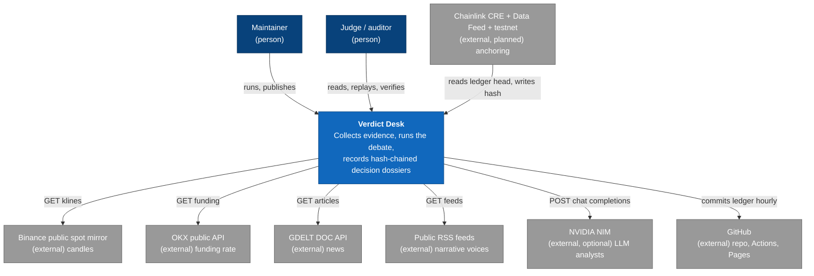
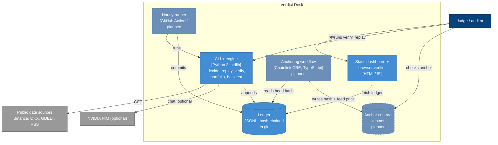
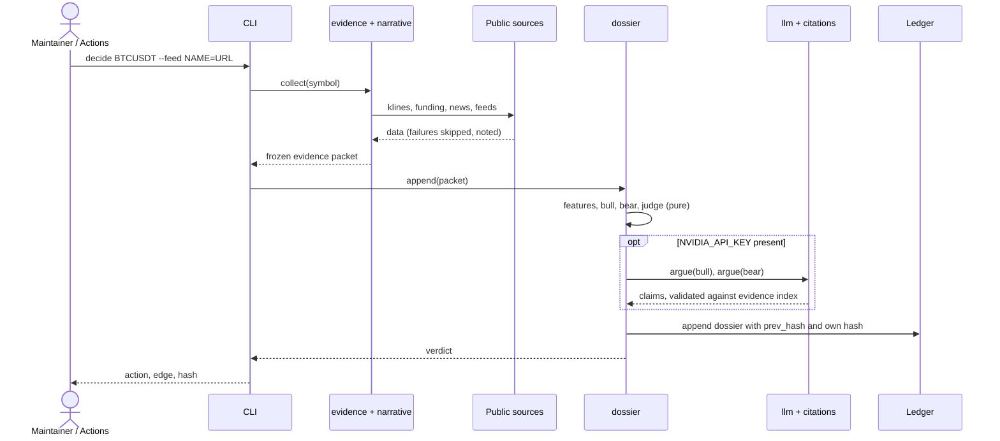

# Architecture: Verdict Desk

> Status: Draft · Last updated: 2026-10-17 · Scope: BLI Legal Tech Hackathon 2, bounties "Autonomous Agents" (RYO-CHAN) and "Best CRE workflow" (Chainlink)

No SRS exists for this project. Drivers below come from the bounty text, the project strategy (`../../ESTRATEGIA.md`) and the constraints in section 2, and are stated in prose. Each section marks what is **Built** (in the repo today: 67 Python tests, 10 anchor workflow tests, 6 contract tests) and what is **Planned** (designed, not yet written). Nothing planned is presented as done.

## 1. Introduction and Goals

Verdict Desk is a market-reasoning agent desk that produces **audit-grade decision dossiers**. For each decision it collects public market evidence, freezes it, lets a bull agent and a bear agent argue over the same evidence, and lets a deterministic judge size a **simulated** position inside declared risk limits. Every dossier is hash-chained to the previous one, so a lawyer, auditor or judge can re-run the reasoning and detect tampering. No real order is ever placed.

The legal angle fits the organizer (Blockchain Legal Institute): a dossier is built to be read like a verifiable report, not a chat log.

**Top quality goals, in priority order**

1. **Verifiability and repeatability.** A third party can recompute every deterministic step from the frozen evidence and detect any edit to history. Driver: the bounty asks for "a repeatable reasoning trail".
2. **Grounding and honesty.** Every claim traces to an evidence item; no invented metrics; negative results are published. Driver: bounty asks for "cause and effect"; honesty is also a hard rule of the project.
3. **Zero cost and zero setup.** Runs on stock Python 3 with no paid API and no installed dependency, so any judge can reproduce it in one command. Driver: project budget is zero.
4. **Graceful degradation.** A dead news feed or a missing LLM key must reduce evidence, never crash a run or silently change results.

**Stakeholders.** Hackathon judges (want a demo that runs and a trail they can check), the organizer's legal audience (wants verifiability), the maintainer (wants cheap operation and few moving parts).

## 2. Constraints

| Constraint | Effect on the design |
|---|---|
| Submission due 2026-10-31 22:01 (DoraHacks time); internal cut-off 2026-10-22 for an end-to-end demo with LLM | Small modular core, reuse of what exists, no new platforms |
| Budget zero | Public keyless data, free LLM tier only, free hosting (GitHub) |
| Brazil-based maintainer | Binance futures API is blocked by location; the public spot mirror is used |
| LLM key (NVIDIA NIM) currently absent in the cloud environment | LLM layer is optional and injectable; the core runs alone |
| No X (Twitter) API | Narrative agent reads public RSS feeds instead |
| Original code, MIT license, third-party code only credited | The automaton's journal is used as a data source only, never as submitted code |
| Judge-facing text in American English | This document, README, dashboard and video script |
| Simulation only | No order routing, no keys with trading rights, anywhere |

## 3. Context and Scope

**Inside the boundary:** evidence collection, feature computation, the debate and judge, the LLM citation validator, the ledger, replay and verification, the simulated portfolio, the backtest, the static dashboard and browser verifier.
**Outside:** all data providers, the LLM, GitHub hosting, and the Chainlink network.

## 4. Solution Strategy

- **Single-process, stdlib-only Python package** with pure functions for everything that decides, and I/O only at the edges (ADR-004).
- **Freeze, then decide.** Evidence is collected once into a self-contained packet embedded in the dossier; all deterministic logic reads only that packet (ADR-002).
- **Deterministic judge, LLM analysts on a leash.** LLM output is accepted only if it cites existing evidence ids and uses only numbers present in the cited items; the judge never uses the LLM (ADR-001).
- **Append-only hash-chained JSONL ledger in git**, with git history as an independent timestamp witness (ADR-003, ADR-009).
- **Backtest kept separate from the live ledger**, rules versioned and fixed, losses published (ADR-006).
- **Browser verifier and Chainlink CRE anchoring** as independent checks that do not depend on trusting the operator (ADR-007, ADR-008).

## 5. Building Block View

Dashed blocks are planned. The engine's modules (package `verdict_desk`):

| Module | Responsibility | Purity |
|---|---|---|
| `evidence` | Fetch candles, funding and news; assemble the frozen evidence packet with source URL and timestamp | I/O |
| `narrative` | Read public RSS and Atom voices; an LLM extracts token, stance, conviction and urgency per headline; a grounding gate keeps only extractions whose quote is literal in the headline; convergence needs two distinct voices; keyword mode is the labeled fallback | I/O + pure |
| `features` | Compute indicators (EMA, 24-candle range, ATR, volume ratio, news tone) from the packet only | pure |
| `agents` | Bull and bear rule sets; deterministic judge sizing a simulated position (1% risk, ATR stop and target) | pure |
| `citations` | Build the evidence index (E1, E2, ...) and validate LLM claims against it | pure |
| `llm` | NVIDIA NIM client, tolerant JSON parser, injectable `ask` for offline tests | I/O (optional) |
| `dossier` | Build, chain, append, replay and verify dossiers | pure + file append |
| `portfolio` | Mark simulated positions against later recorded candles; stop wins ties | pure |
| `backtest` | Walk-forward run of the same rules on past candles, with fees and a series hash | I/O + pure |

Dependencies point inward: `dossier` depends on `features`, `agents`, `citations`, `llm`; `features` and `agents` depend on nothing but the standard library. Only `evidence`, `narrative`, `llm` and the CLI touch the network.

## 6. Runtime View

**Scenario A: record a decision (`decide`).**

**Scenario B: verify and replay (`verify`, `replay`).** `verify` walks the ledger and checks that each `prev_hash` matches the previous record and that each hash equals the SHA-256 of the canonical body. `replay` recomputes features and the verdict from the frozen packet and compares them to what was recorded; for the LLM layer it cannot regenerate text, so it re-validates every accepted claim against the frozen evidence and checks that the evidence index is unchanged.

**Failure behavior.** A failed feed is skipped and printed; a failed news call yields an empty article list with the error recorded; an LLM error is stored in the dossier and the deterministic decision still stands; missing funding data disables the funding arguments only.

## 7. Deployment View

| Environment | What runs | Status |
|---|---|---|
| Local | `python -m verdict_desk ...`, `python -m unittest discover` | Built |
| Live (public repo) | GitHub Actions cron runs `decide` hourly and commits the ledger; GitHub Pages serves the dashboard; CRE workflow anchors the head hash daily | Planned, blocked on repo creation scope |

No server, database or container is needed. Hosting cost is zero. The live environment is the same code on a schedule, not a different build.

## 8. Cross-cutting Concepts

**Security and trust model.** The hash chain proves **integrity after recording**, not **authenticity at collection time**: an operator could in principle fabricate a packet before hashing it. The design narrows that gap with independent witnesses: (1) every packet carries its source URL and timestamp, and historical candles can be re-fetched by anyone and compared; (2) git history, written by an hourly job in a public repo, timestamps each commit outside the operator's clock; (3) the planned CRE anchor writes the head hash to a testnet with an oracle price, which a later edit cannot rewrite. Secrets: the only secret is `NVIDIA_API_KEY`, read from the environment and never written to a dossier or log. There is no key with trading rights anywhere.

**Data.** One append-only JSONL file; one line per dossier; canonical JSON (sorted keys, compact separators) hashed with SHA-256; genesis hash is 64 zeros. Each dossier embeds its own evidence (about 72 candles), so lines are self-contained and verifiable in isolation. Migration: the rules carry `rules_version` ("v1"); a new rule set ships as v2 and never rewrites v1 history.

**Resilience.** Per-call timeouts, no retries (the next hourly run is the retry), failure isolated per source, GDELT called at most once every 5 seconds. Idempotency is not needed because each run creates a new timestamped dossier.

**Observability.** CLI prints the verdict, the arguments with their evidence references, and rejected LLM claims with the reason. The dashboard shows the fita of decisions and link consistency. Actions logs and commit times serve as the operational record.

**Performance.** A run takes seconds, dominated by the 5-second GDELT spacing. Ledger growth is roughly tens of KB per dossier (embedded candles); hourly operation is a few MB per month. Not a concern for the hackathon window.

**Testing.** Strategy: many fast unit tests over pure functions, no network in tests. Framework: Python `unittest` from the standard library (no dependency, in line with ADR-004). LLM paths are tested through an injected `ask` stub. 67 Python tests pass today (plus 10 workflow tests under `cre/anchor` and 6 EVM contract tests), including: narrative grounding gate rejects invented quotes, unknown voices and out-of-vocabulary values; a failed symbol is a visible gap, never a fake decision; citation validator rejections, replay detects an altered claim, hash chain detects edits, backtest does not leak the future, fees apply on both sides. Critical flow for end-to-end checking: `decide` then `verify` then `replay` on a fresh ledger (Planned as a single scripted check run by Actions after each commit). Coverage stance: none (no percentage gate; criterion coverage is tracked by the test names above, since a percentage measures execution, not assertion quality). The browser verifier is tested through Node (`tests/node_verify.js`) on 9 cross-language vectors and a real ledger; the page itself was exercised once in Chromium, not by a CI test.

## 9. Architecture Decisions

### ADR-001: Deterministic judge; LLM analysts bound by a citation validator

**Status:** Accepted · **Date:** 2026-10-12
**Requirements addressed:** repeatable reasoning trail; cause and effect (bounty text); grounding goal

**Context.** A bounty for "autonomous agents" can look like "just rules" if no LLM is involved, but an LLM in the decision path breaks exact replay and invites invented numbers.

**Decision.** Bull, bear and narrative agents may use an LLM, but each claim must cite evidence ids, and any number in a claim must appear in the cited items, or the validator discards it. The judge (action, size, stop, target) stays deterministic. LLM output is frozen in the dossier.

**Options considered.**
- **Deterministic judge + validated LLM analysts (chosen).** Replay stays exact for the part that decides; the LLM adds readable reasoning without being trusted. Con: LLM text itself cannot be regenerated, only re-validated.
- **LLM judge.** More "agentic", but non-reproducible and unauditable. Lost on the main goal.
- **Rules only.** Fully reproducible but weak against a "show me an agent" criterion.

**Consequences.** Replay reports `llm_citations_valid` instead of regenerating text. The LLM layer is optional and currently untested against the real API (no key). Revisit if judges expect the LLM to influence the verdict.

### ADR-002: Embed frozen evidence in every dossier

**Status:** Accepted · **Date:** 2026-10-12
**Requirements addressed:** repeatability; verifiability by third parties

**Decision.** Each dossier stores the full evidence packet it used, with source URLs and collection time, instead of references to be re-fetched later.

**Options considered.** *Embedded packet (chosen)*: self-contained, replay works offline and after sources change; cost is ledger size. *References only*: small, but replay breaks when an API changes or removes data.

**Consequences.** Larger JSONL lines; trivial offline verification; the evidence index ids (E1, E2, ...) are stable for a given packet. Revisit if the ledger outgrows git comfort (compress or shard by month).

### ADR-003: Append-only SHA-256 hash chain in a JSONL file

**Status:** Accepted · **Date:** 2026-10-12
**Requirements addressed:** tamper evidence; zero cost; simple third-party tooling

**Decision.** One JSON object per line; `hash = SHA-256(canonical body)`; each body includes `prev_hash`.

**Options considered.** *JSONL chain (chosen)*: readable, diff-able, any language can verify. *SQLite*: queryable but opaque in review and needs tooling. *Chain-only on a blockchain*: costly and slow per decision; used only for periodic anchoring (ADR-008).

**Consequences.** Editing any past line breaks every later hash. Canonical JSON must be identical across languages (see ADR-007).

### ADR-004: Python 3 standard library only

**Status:** Accepted · **Date:** 2026-10-12
**Requirements addressed:** zero setup; budget zero

**Decision.** No third-party packages; HTTP via `urllib`, tests via `unittest`, XML via `xml.etree`.

**Options considered.** *Stdlib (chosen)*: a judge runs it with `python3` and nothing else. *requests/pandas/pytest*: nicer ergonomics, but an install step and supply-chain surface for no scoring gain.

**Consequences.** More verbose HTTP and statistics code; no wheel or lockfile to maintain. Revisit only if a needed feature (for example heavy numeric work) is impractical without a library.

### ADR-005: Public, keyless data sources only

**Status:** Accepted · **Date:** 2026-10-12
**Requirements addressed:** budget zero; Brazil location; no X API

**Decision.** Candles from the Binance public spot mirror (`data-api.binance.vision`), funding from OKX public endpoints, news from GDELT, narrative from public RSS feeds. The automaton's trade journal is used only as a data source.

**Options considered.** *Public keyless (chosen)*. *Binance futures API*: blocked from Brazil. *X API*: paid. *Paid news APIs*: break the zero budget.

**Consequences.** Coverage is limited to what free endpoints expose (no historical funding or news for backtests, GDELT rate limit). Every source can vanish or throttle, which the degradation rules handle.

### ADR-006: Fixed, versioned rules; backtest separate from the live ledger

**Status:** Accepted · **Date:** 2026-10-16
**Requirements addressed:** honesty goal; "simulated operations" in the bounty

**Context.** A first backtest of rules v1 (1h candles, 4,000 per symbol, fee 0.05% per side, one position at a time, 48-candle time exit) lost money after costs: BTC -19.8%, ETH -10.0%, SOL +1.2% (buy and hold -0.9%, +0.6%, +17.0%). Gross of fees BTC returned +5.7%.

**Decision.** Rules are not tuned to the test data. The backtest is a separate command, labeled as past data, with parameters and a SHA-256 of the candle series in its output so anyone can reproduce it. The result is published as is. Any improvement ships as v2 chosen on an older training window and measured on a newer one; v1 history is never rewritten.

**Options considered.** *Publish honest negative result (chosen)*: consistent with the bounty (it grades reasoning and traceability, not profit) and with judges' trust. *Tune until positive*: in-sample fit that would not survive scrutiny. *Hide the backtest*: loses the "walk-forward" strength.

**Consequences.** The headline is process quality, not returns. Update 2026-10-17: the v2 study with a fixed time split was run (`research/README.md`, `python -m verdict_desk research`). v2 beat v1 out of sample on 3 of 3 symbols but was net positive on 1 of 3 and never beat buy and hold, so v1 stays live; `agents.Rules` makes a future v2 a parameter set with its own `rules_version`, never a rewrite of v1 history.

### ADR-007: Browser verifier needs one canonical number format across Python and JavaScript

**Status:** **Accepted and built** · **Date:** 2026-10-16, implemented 2026-10-17
**Requirements addressed:** verifiability by third parties without running the operator's code

**Context.** The Python side hashes `json.dumps(..., sort_keys=True, separators=(",", ":"))`. Python prints a float like `100.0` as `100.0` and `5.8e-05` as `5.8e-05`; JavaScript prints them as `100` and `0.000058`. After `JSON.parse`, JavaScript also cannot tell `100.0` from `100`. A browser that re-serializes a dossier would compute a different hash than Python for the same content. Today the dashboard only checks that `prev_hash` links are consistent, not the hashes themselves.

**Decision.** Adopt one number format that both sides produce: RFC 8785 style, with numbers rendered the way ECMAScript renders them. Python gets a small `canonical()` that formats floats that way (shortest round-trip digits from `repr`, then ES6 layout rules), and the browser verifier uses `JSON.stringify` with sorted keys. Do the switch **before the first public ledger commit**, while no live history exists to migrate.

**Options considered.**
- **ES6-style numbers in Python (proposed).** One-time change to `canonical()`, clean for any JavaScript verifier. Con: custom formatting code that needs tests.
- **Re-implement Python float printing in JavaScript.** Needs source-text access when parsing to keep `100.0` apart from `100`; fragile across engines.
- **Store the canonical body as a string in the ledger line.** Trivial to hash in any language, but then the readable fields must be derived from the string, which changes the ledger format and its readability.

**Consequences.** Ledger v2 format, existing tests for hashing change, and a cross-language test vector set (numbers such as 100.0, 5.8e-05, 1e21, 0.1+0.2) is required. Revisit if a simpler approach emerges.

### ADR-008: Chainlink CRE workflow anchors the ledger head and an oracle price

**Status:** Accepted in principle, **Planned** · **Date:** 2026-10-12
**Requirements addressed:** Chainlink bounty (CRE as orchestration layer joining a blockchain to an API, LLM or agent; simulation by the CRE CLI or live deploy); tamper evidence beyond the operator

**Decision.** A CRE workflow (TypeScript SDK) runs on a daily trigger: it fetches the published ledger head hash over HTTP, reads a Data Feed price for the traded asset, and writes the head hash and price to a minimal anchor contract on a testnet. The price doubles as independent cross-check evidence for the dossier.

**Options considered.** *CRE workflow (chosen)*: meets the bounty and runs decentralized, verifiable execution. *Plain cron plus web3 script*: simpler, but gives no CRE credit and the operator controls the writer. *No anchor*: weaker tamper story.

**Consequences.** Needs a testnet wallet and CRE CLI access; every CRE API detail must be verified against the current Chainlink documentation before coding (this document does not assume them). If time runs out, the project ships the deterministic core and drops the anchor, keeping the git-timestamp witness.

### ADR-009: Hourly GitHub Actions run commits the ledger to a public repo

**Status:** Accepted in principle, **Planned (blocked)** · **Date:** 2026-10-12
**Requirements addressed:** independent timestamps; "live history" credibility

**Decision.** A scheduled workflow runs `decide` and commits the new ledger line. The commit time and public repo history act as a witness the operator does not control.

**Options considered.** *GitHub Actions (chosen)*: free, public, timestamped. *Maintainer's VPS cron*: reliable, but timestamps are self-asserted and the history is private.

**Consequences.** GitHub scheduled runs are best effort and can be delayed or skipped; the dashboard must show real gaps rather than hide them. Two repository facts must change first: the public repo must exist (it needs the owner's go-ahead), and the ledger lives in the tracked `ledger/ledger.jsonl` (`data/` stays ignored for scratch runs).

## 10. Quality Requirements

| Scenario | Target | Status |
|---|---|---|
| Edit any recorded dossier field, then run `verify` | Reports that dossier and every later one | Built, tested |
| Run `replay` on every dossier from the frozen evidence | Same verdict for 100% of deterministic dossiers | Built, tested |
| LLM claim cites an unknown id or a number not in the cited evidence | Claim rejected with a reason, decision unaffected | Built, tested (stub only) |
| Run with no network sources reachable | Dossier still recorded with whatever evidence exists, errors visible | Built for news and feeds; candle failure aborts the run by design |
| Reproduce a published backtest from its parameters and series hash | Identical numbers | Built, tested on synthetic data |
| Open the dashboard (or any ledger file) | Every SHA-256 recomputed in the browser matches Python's; an edited dossier is flagged | Built; tested in Node against Python on 9 canonical vectors and on a real ledger, and checked once in Chromium |

## 11. Risks and Technical Debt

1. **Rules v1 do not make money after costs** (BTC -19.8% in the backtest). Mitigation: ADR-006 stance, v2 with a train/test split, and keep the pitch on traceability.
2. **The LLM layer has never run against the real API.** No key in the cloud environment; behavior, latency and the claim format are untested. This is the cut-off item for 2026-10-22.
3. ~~Browser verifier cannot recompute hashes~~ Closed on 2026-10-17 (ADR-007): `verdict_desk/canonical.py` and `web/canonical.js` produce the same RFC 8785 text. Remaining gap: the browser checks hashes and links, not `replay` (features and judge are Python).
4. **Ledger path is gitignored and the public repo does not exist yet** (ADR-009). The live-history argument starts only when this is fixed; every day of delay is lost history.
5. **Integrity is not authenticity.** See the trust model in section 8; the anchor (ADR-008) is the strongest mitigation and is not built.
6. **Rules, eligibility and payout terms are unpublished** by the organizer, and the Q&A page is not reachable from the cloud environment. Risk that deliverables change late.
7. **Closest rival (EvidenceTrail)** also claims a hash-chained, replayable trail. Differentiators to keep sharp: the independent verifier, the legal-report dossier format, the narrative agent, the honest walk-forward backtest, and the CRE anchor.
8. **Free data fragility.** GDELT throttles to one call per 5 seconds; the Binance mirror and OKX can change without notice.
9. **Deliberate shortcut:** no retries, no concurrency, one position at a time in the backtest, ATR-based sizing with a fixed 1% risk. Fine for a simulation; revisit before anything resembling real use.

## 12. Glossary

- **Dossier:** one ledger record: frozen evidence, features, bull and bear arguments, verdict, optional LLM layer, and hashes.
- **Frozen evidence packet:** the collected data a decision used, stored inside the dossier.
- **Edge:** bull score minus bear score; a position opens when its absolute value reaches the threshold (2.0).
- **Replay:** recomputation of a decision from its frozen evidence only.
- **ATR:** average true range, used for stop and target distances.
- **CRE:** Chainlink Runtime Environment, the workflow layer used for the anchoring flow.
- **Walk-forward:** evaluation in which each decision sees only data before it.
